<p align="center">
  <a href="https://cosenza-tech.netlify.app/"></a>
</p>

<p align="center">
  
</p>


**Support & Hardware Technician** com mais de cinco anos de experiência em suporte técnico N1 e N2, redes LAN/WAN e VPN, firewall, servidores e Active Directory. Formação em Análise e Desenvolvimento de Sistemas e cursos em cibersegurança, Python e SQL Server. Valorizo a boa comunicação e o trabalho em equipa para manter utilizadores e infraestruturas a funcionar com segurança.


```bash
$ cat experiencia.log
```

> **▸ Support & Hardware Technician** · Elevar Global Lda. · `ago 2026 – atualmente`<br>
> Suporte N1/N2 presencial e remoto · servidores e Active Directory · redes LAN/WAN, VPN e firewall · postos de trabalho

> **▸ Support & Hardware Technician** · Centralgest Software · Mealhada · `jun 2025 – ago 2026`<br>
> Suporte N1/N2 · hardware e software · software Centralgest · equipamentos de rede e firewall · estabilidade dos sistemas

> **▸ Support & Hardware Technician** · Filosoft · `mai 2024 – jun 2025`<br>
> Suporte N1/N2 · manutenção preventiva e corretiva · servidores e Active Directory · redes LAN/WAN, VPN e firewall


| ▸ módulo | o que faço |
| --- | --- |
| `suporte_tecnico` | Apoio a utilizadores e resolução de incidentes de hardware, software e acessos |
| `redes` | Gestão e manutenção de redes e da conectividade da infraestrutura |
| `ciberseguranca` | Firewall (pfSense/Sophos), VPN, monitorização e boas práticas de segurança |
| `servidores` | Windows Server, Active Directory e GPO; Linux (Debian/Ubuntu/CentOS) |
| `dados_e_sistemas` | SQL Server e sistemas de gestão empresarial (ERP) |


<p align="left">
  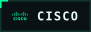
  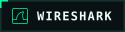
  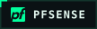
  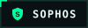
  
  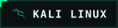
  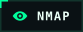
  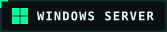
  
  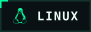
  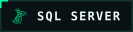
  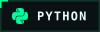
</p>


<p align="center">
  <a href="https://www.instagram.com/camada.8/"></a>
</p>

<p align="center">
  <a href="https://www.instagram.com/camada.8/"></a>
  <a href="https://linktr.ee/camada.8"></a>
</p>


<p align="center">
  <a href="https://cosenza-tech.netlify.app/"></a>
  <a href="https://www.linkedin.com/in/caio-cosenza-31b562156"></a>
  <a href="mailto:cvasconcelos.caio@gmail.com"></a>
</p>


<p align="center">
  
</p>

